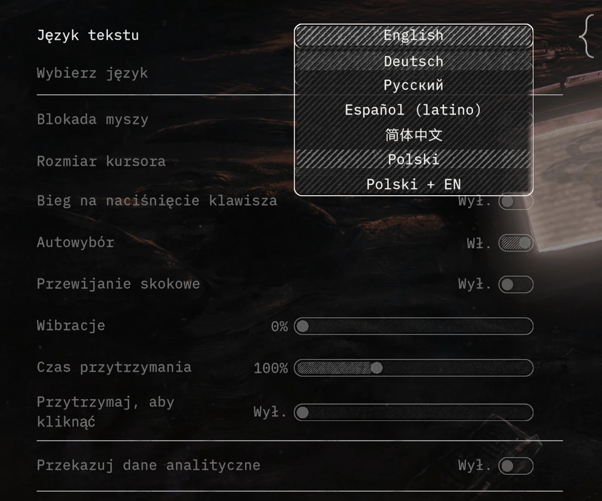
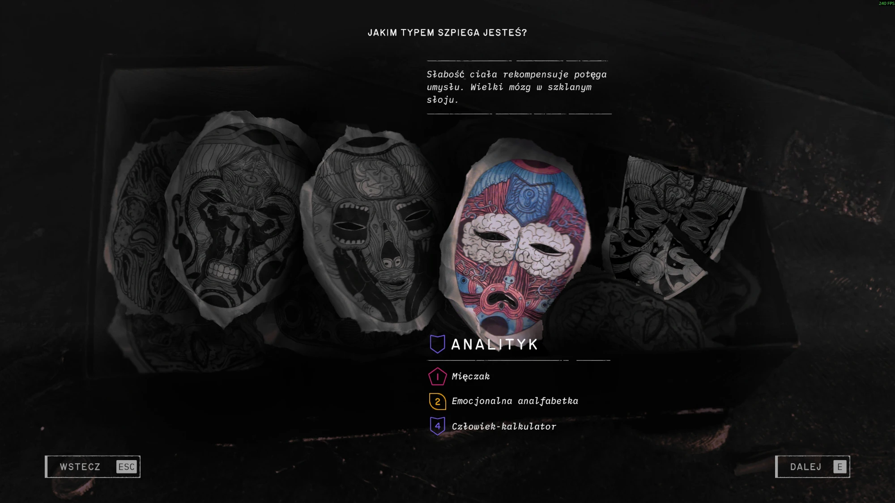
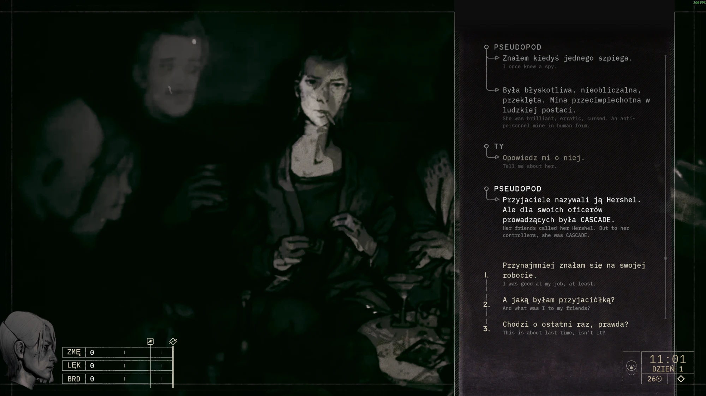

# Zero Parades: For Dead Spies - polskie tłumaczenie

Nieoficjalne, fanowskie tłumaczenie gry **Zero Parades: For Dead Spies** (ZA/UM) na język polski.
Dodaje do gry dwa nowe języki, nie zabierając żadnego istniejącego:

- **Polski** - pełne tłumaczenie,
- **Polski + EN** - polski tekst z małym, szarym angielskim oryginałem pod każdą linią dialogu
  (przydaje się, gdy coś brzmi dziwnie i chcesz sprawdzić, co było w oryginale).

Przetłumaczone jest 100 % tekstu gry (ok. 73 700 wpisów, w tym 67 600 linii dialogów).
Wersja **beta** - testowana na Steamie (Windows).

## Zrzuty ekranu

| Wybór języka w ustawieniach | Tworzenie postaci | Dialog w trybie „Polski + EN” |
|---|---|---|
|  |  |  |

## O tłumaczeniu

Tłumaczenie powstało w przeważającej części z pomocą AI (modele Claude firmy Anthropic), pod nadzorem człowieka:
ze wspólnym glosariuszem nazw i terminów, kilkoma rundami przeglądu całego tekstu i redakcją literacką
najważniejszych rozmów. Nie jest to praca zawodowego tłumacza, więc mogą się trafić błędy w odmianie,
niekonsekwencje (np. „ty” / „pan” w zwracaniu się do kogoś) albo niezręczne zdania.

**Widzisz błąd?** Zgłoś go w [Issues](https://github.com/vQass/ZeroParades_PL/issues). Najbardziej pomoże:

- polski tekst, który jest źle (wystarczy fragment),
- angielski oryginał - w trybie „Polski + EN” widać go pod linią.

Każda uwaga się przyda - także „to brzmi nienaturalnie” albo „ta postać mówi do mnie raz na ty, raz na pan”.

## Instalacja

### 1. Python (jednorazowo)

Instalator jest skryptem w Pythonie, więc potrzebny jest Python 3.11 lub nowszy.

1. Pobierz go ze strony [python.org/downloads](https://www.python.org/downloads/) i uruchom instalator.
2. **Na pierwszym ekranie zaznacz „Add python.exe to PATH”**, potem „Install Now”.
3. Sprawdź: otwórz menu Start → wpisz `cmd` → w oknie wpisz `python --version`. Powinna pojawić się wersja,
   np. `Python 3.13.0`. Jeśli zamiast tego otwiera się Microsoft Store albo pojawia się błąd, Python nie jest
   w `PATH` - zainstaluj go ponownie z zaznaczoną opcją z punktu 2.

### 2. Tłumaczenie

1. Pobierz paczkę z tłumaczeniem (zakładka **Releases** albo zielony przycisk **Code → Download ZIP**)
   i rozpakuj ją do dowolnego folderu, np. `C:\Gry\ZeroParades_PL`. **Nie usuwaj tego folderu po
   instalacji** - w podfolderze `backup\` zostają kopie oryginalnych plików gry.
2. Zamknij grę.
3. Znajdź folder gry: w Steamie kliknij grę prawym przyciskiem → **Zarządzaj → Przeglądaj pliki lokalne**.
   Otworzy się folder z podfolderem `ZeroParades_Data`. Skopiuj jego ścieżkę z paska adresu Eksploratora,
   np. `G:\SteamLibrary\steamapps\common\Zero Parades`.
4. Kliknij dwa razy **`zainstaluj.bat`**, wklej ścieżkę do folderu gry i naciśnij Enter.
   Skrypt doinstaluje potrzebne biblioteki Pythona i wgra tłumaczenie (ok. pół minuty); na końcu wypisze „Gotowe”.
   Jeśli Windows wyświetli ostrzeżenie o nieznanym pliku, wybierz „Więcej informacji → Uruchom mimo to”
   (skrypty są jawne - możesz je przejrzeć w folderze `tools\`).
5. Uruchom grę i wybierz język: **Settings → Gameplay → Language → „Polski”** albo **„Polski + EN”**
   (po polsku: Ustawienia → Rozgrywka → Język).

Instalację można bezpiecznie powtarzać - zawsze startuje od kopii oryginalnych plików z `backup\`.

### Po aktualizacji gry lub tłumaczenia

- **Gra zaktualizowała się przez Steam** - tłumaczenie znika, uruchom ponownie `zainstaluj.bat`.
  Skrypt sam wykryje nową wersję gry i zrobi nowe kopie oryginałów.
- **Nowa wersja tłumaczenia** - rozpakuj ją **do tego samego folderu** (nadpisując pliki, żeby został
  `backup\`) i uruchom `zainstaluj.bat`. Jeśli wolisz nowy folder, najpierw przywróć grę do oryginału
  (patrz niżej: sprawdzenie spójności plików w Steamie), a dopiero potem instaluj.

## Odinstalowanie

Kliknij dwa razy `odinstaluj.bat` i podaj folder gry - oryginalne pliki wrócą z `backup\`.
Albo w Steamie: grę prawym przyciskiem → **Właściwości → Zainstalowane pliki → Sprawdź spójność plików gry**.

## Instalacja z wiersza poleceń

To samo, co robi `zainstaluj.bat`:
```
zainstaluj.bat "G:\SteamLibrary\steamapps\common\Zero Parades"
```
albo krok po kroku:
```
pip install -r requirements.txt
python tools/add_language.py --game "<folder gry>" --texts translation/pl.json --bilingual --apply
```
Z `--out <folder>` zamiast `--apply` zmienione pliki trafią do wskazanego folderu, a gra pozostanie nietknięta.
Bez `--bilingual` dodany zostanie tylko język „Polski”. Odinstalowanie: `python tools/install.py --game "<folder gry>" --restore`.

## Jak to działa

- W paczce jest **wyłącznie polski tekst** (`translation/pl.json`: klucz gry → tłumaczenie) i instalator.
  Nie ma tu żadnych plików gry ani oryginalnych tekstów.
- Gra używa własnego systemu lokalizacji ZA/UM (Unity 6, IL2CPP, Addressables). `tools/add_language.py` dopisuje do
  bundla lokalizacji nowe tabele (`pl` = 80 i „Polski + EN” na kodzie `fo` = 45), rejestruje je w ustawieniach języków
  i w menu, przełącza czcionki LiberationSans SDF w tryb dynamiczny (polskie znaki) i aktualizuje `catalog.bin`
  (`tools/catalog_bin.py`). Angielskie oryginały do wersji „Polski + EN” instalator czyta z plików gry na Twoim dysku
  (`tools/en_from_game.py`) - dlatego ten wariant powstaje dopiero w trakcie instalacji.
- `tools/install.py --restore` przywraca oryginały z `backup\`.

## Prawa i licencja

Projekt fanowski, niezwiązany z ZA/UM. Zero Parades: For Dead Spies © ZA/UM - wszystkie prawa do gry i jej
oryginalnych tekstów należą do ZA/UM. Repozytorium nie zawiera plików gry.

- Tłumaczenie (`translation/`): [CC BY-NC-SA 4.0](https://creativecommons.org/licenses/by-nc-sa/4.0/deed.pl) -
  można je kopiować i zmieniać do celów niekomercyjnych, z podaniem źródła i na tej samej licencji.
- Skrypty (`tools/`, pliki `.bat`): licencja MIT.

Szczegóły: `LICENSE.md`.
